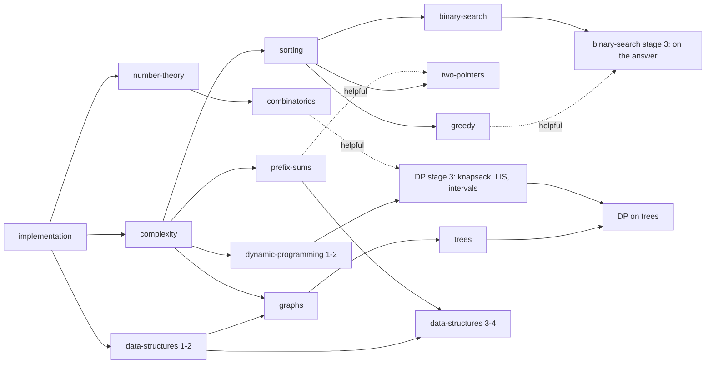

# Proposal 0001 — Olympiad domain model and learning design

> **Historical design document.** It records decisions made at the time. Counts of problems and tests are out of date, and this public repository ships only the synthetic `sample-sum` package.

Status: **Approved (C1–C8, 2026-10-24). Phase 2 subset implemented**, with these
deviations decided during implementation:

| # | Proposal said | Implemented | Why |
|---|---|---|---|
| D1 | `hint_reveals(user, hint_id)` | `(user, problem, ordinal)` | A reveal must apply in every language. |
| D2 | `submissions.problem_set_id` | deferred to Phase 4 | No `problem_sets` table yet; no dangling FK. |
| D3 | "demonstrated" = band + checkpoint | ≥ 2 hint-free judged accepts at stage ≥ s | Checkpoints need learning paths (Phase 4). |
| D4 | retention, mixed-set metrics | not computed yet | Need contests/paths data. |
| D5 | Kyrgyz drafts flagged | no Kyrgyz statements | Content quality over machine-quality coverage. |
| D6 | 1 MiB per test | 4 MiB per test input | Inputs with n = 200 000 need ~2–4 MiB. |
| D7 | authoring endpoints in Phase 2 | content via `content/` + importer; admin review/publish API | Authoring UI is a Phase 4 teacher tool. |
| D8 | C++ reference verified in DB | verified by CI (`test_content.py` with g++), not by the importer | The importer does not compile code. |
Author role: curriculum architect. Date: 2026-10-24.

Scope: the Olympiad module (Module A) for Phases 2–4. It refines the *planned* model in
`docs/ARCHITECTURE.md` and the Phase 2 table in `docs/API_CONTRACT.md`. Every change to
those shared contracts is listed in §9 and needs explicit approval.

---

## 1. Design principles

1. **Topics are a curriculum, tags are labels.** Topics form a reviewed, ordered graph that
   drives learning paths. Tags are lightweight, searchable technique labels
   (`off-by-one`, `overflow`, `monotonic-stack`) that never gate anything.
2. **Difficulty is an estimate with visible provenance**, never an official rating (§4).
3. **Evidence over counts.** Progress shows *what a student has demonstrated*
   (e.g. "solved 3 Medium prefix-sum problems without hints"), not a single score (§7).
4. **Works without a judge or an LLM.** Hints, editorials, paths and self-assessment all
   function with `NoJudge`. Judging adds verified evidence; it does not unlock the product.
5. **Provenance is data.** Authorship, license and review state are required columns,
   not free-text notes.

## 2. Problem taxonomy

Top-level topics (slug), with stage-1 subtopics. Stages are ordered within a topic
(1 = introduction … 4 = olympiad-ready). The tree is seed data, editable by admins.

| Topic | Stage 1–2 (intro) | Stage 3–4 (olympiad) |
|---|---|---|
| `implementation` | I/O, loops, conditions, arrays, strings, simulation | careful simulation, parsing, grids |
| `complexity` | counting operations, reading constraints → target O(·) | amortized analysis, choosing between approaches |
| `sorting` | built-in sort, custom comparators, counting sort | sorting + sweep, coordinate compression |
| `prefix-sums` | 1D prefix sums, difference arrays | 2D prefix sums, prefix sums over maps/XOR |
| `binary-search` | search in sorted array, lower/upper bound | binary search on the answer, on real numbers |
| `two-pointers` | merging, pair sums on sorted data | sliding window with constraints |
| `greedy` | exchange-argument basics, sorting-based greedy | proofs of greedy choice, greedy with heaps |
| `number-theory` | divisibility, GCD/LCM, primes, sieve | modular arithmetic, inverses, fast exponentiation |
| `combinatorics` | counting principles, binomials | binomials mod p, inclusion–exclusion |
| `data-structures` | stack, queue, deque, set/map, heap | DSU, Fenwick tree, segment tree, sparse table |
| `graphs` | representation, BFS, DFS, connected components | Dijkstra, topological sort, MST, 0-1 BFS |
| `trees` | traversal, parent/depth, subtree sizes | Euler tour, LCA (binary lifting), rerooting |
| `dynamic-programming` | 1D DP, grid paths | knapsack, LIS, interval DP, bitmask, DP on trees |

## 3. Prerequisite graph

Edges are **topic-stage → topic-stage** with a strength: `required` (shown as a lock-free
"recommended first" warning — we never hard-block a student) or `helpful`.

Rules: the graph must be acyclic (validated on write, tested); recommendations use
`required` edges only; `helpful` edges only order suggestions.

## 4. Difficulty: assignment, review, revision

We show **bands**, never numbers that imply precision, and always show who stands behind
the label.

| Band | Meaning (anchored to the curriculum, not to any external system) |
|---|---|
| Intro | One idea from a stage-1 topic, direct statement. |
| Easy | One stage-1/2 idea, needs translating the story into the idea. |
| Medium | A stage-3 idea, or two stage-1/2 ideas combined. |
| Hard | Stage-4 idea, or a non-obvious combination; needs proof-level reasoning. |
| Challenge | Beyond the curriculum's stated stages. |

Lifecycle (`difficulty_status`):

1. **`author_estimate`** — author picks a band and writes a one-line rationale
   ("needs prefix sums + noticing sums fit in int64"). UI label: *"Author's estimate"*.
2. **`reviewed`** — a second person (not the author; teacher or admin) confirms or changes
   it. UI label: *"Reviewed estimate"*.
3. **Empirical check (Phase 3+, judge required)** — after ≥ 30 distinct students with
   judged attempts, we compute first-attempt acceptance and median attempts-to-accept,
   **compared within the band**. Outliers are *flagged for re-review*; the band is never
   changed automatically. Self-selection bias (strong students try hard problems) is
   noted next to any statistic.

Every band change writes an `audit_logs` row (`problem.difficulty_changed`, with old,
new, rationale). We never import or display ratings from external judges, and we never
call a band an "official" or "olympiad" difficulty.

## 5. Data model

Changes vs the planned model are marked **(new)** or **(changed)**. All tables have
UUID PKs and `created_at`/`updated_at` unless noted.

**Curriculum**
- `topics(slug, parent_id, ordinal, stage_count)` + `topic_translations(topic_id, locale, name, summary_md)`
- **(new)** `topic_prerequisites(topic_id, topic_stage, requires_topic_id, requires_stage, strength required|helpful)`
- **(new)** `tags(slug)` + `tag_translations`, `problem_tags(problem_id, tag_id)`

**Problems**
- **(changed)** `problems(slug, status draft|in_review|published|archived, difficulty_band, difficulty_status, difficulty_rationale, time_limit_ms, memory_limit_mb, scoring ioi|binary, origin original|licensed|adapted, license (SPDX id, e.g. CC-BY-4.0), attribution_md, authors_md, created_by, generated_with_ai bool)`
  — replaces `difficulty 1–10` and the free-text `source`. `published` requires: license,
  attribution, ≥1 reviewed translation, ≥1 verified reference solution, a non-author approver.
- `problem_translations(problem_id, locale, title, legend_md, input_md, output_md, notes_md, reviewed_by, reviewed_at)`
- **(changed)** `problem_topics(problem_id, topic_id, stage, is_primary)` — the stage is what links a problem to the path.
- **(dropped)** `problem_prerequisites` — replaced by topic-level prerequisites; per-problem
  "solve X first" proved hard to maintain in practice and duplicates the topic graph.
- **(new)** `test_groups(problem_id, ordinal, points, description_md)` — IOI-style subtasks; a binary problem has one group.
- **(changed)** `test_cases(problem_id, group_id, ordinal, input, expected_output, is_sample, generator_note)` — large tests can later move to object storage; limit 1 MiB per case in DB for now.
- `hints(problem_id, ordinal, locale, body_md)` — ordered from nudge → key idea → near-solution.
- `editorials(problem_id, locale, body_md, reviewed_by, reviewed_at)`
- **(changed)** `reference_solutions(problem_id, language, source, author_id, is_primary, verified_at, verified_tests_hash)` — "verified" = passed every test of the current test set (hash detects stale verification).

**Attempts**
- **(changed)** `submissions(user_id, problem_id, problem_set_id nullable, context practice|contest, language, source_code, state queued|judging|done|not_judged|judge_error, verdict accepted|partial|wrong_answer|time_limit|memory_limit|runtime_error|compile_error|null, score 0–100 nullable, hints_revealed_count, judge_token, judged_at)`
  — splits pipeline **state** from **verdict**; snapshots how many hints were open at submit time.
- **(new)** `submission_group_results(submission_id, group_id, verdict, score, max_time_ms, max_memory_kb)` — per-subtask, never per hidden test input.
- **(new)** `hint_reveals(user_id, hint_id, revealed_at)` unique per user+hint
- **(new)** `editorial_unlocks(user_id, problem_id, reason solved|gave_up, unlocked_at)`
- **(new)** `self_reports(user_id, problem_id, claim solved_offline, created_at)` — see §6.3; kept separate so it never mixes with judged evidence.

**Practice structures (Phase 4)**
- `problem_sets(owner_id, title, mode practice|contest, visibility, starts_at, ends_at, duration_min, scoring ioi|icpc, freeze_at, show_topics bool)` + `problem_set_items(problem_set_id, problem_id, ordinal, label)`
- `contest_participations(problem_set_id, user_id, started_at, finished_at, is_virtual)` — supports windowed and virtual contests.
- `learning_paths(slug, title, owner_id, status)` + `learning_path_steps(path_id, ordinal, kind lesson|practice|checkpoint|contest, topic_id, stage, problem_set_id, completion_rule json)`
- `assignments` unchanged from the plan.

## 6. Workflows

### 6.1 Practice
1. Student opens a problem (statement, samples, limits, license line, band + provenance label).
2. Code drafts autosave **in the browser** (localStorage, per problem+language); nothing is
   stored server-side until "Submit". Unsent drafts are the "incomplete submission" case and
   never count as attempts.
3. Submit → `state` path below. Hints can be revealed one at a time at any point; each
   reveal is recorded and shown in history ("solved with 2 of 3 hints").
4. Editorial unlocks after an accepted verdict, or after an explicit "I give up" with a
   confirmation explaining that it is recorded (it costs nothing in metrics beyond being visible to the student).

### 6.2 Verdict handling (student-facing copy, all localized)
| Outcome | What the student sees | Counts as |
|---|---|---|
| `accepted` | Accepted, per-subtask scores | judged evidence |
| `partial` | Score per subtask, which subtasks failed (no inputs) | judged evidence |
| `wrong_answer` / `runtime_error` | Verdict + failing **subtask** (sample inputs shown only for samples) | attempt |
| `time_limit` / `memory_limit` | Verdict + a link to the `complexity` topic note, not a hint for this problem | attempt |
| `compile_error` | Compiler message (truncated, sanitized) | **not** an attempt (doesn't penalize contest score) |
| `not_judged` | "Automatic checking is unavailable. Your code is saved; it will be checked when the checker is back." | nothing yet |
| `judge_error` | "We couldn't check this. It's our fault, not your code." Auto-requeued up to 3× | nothing |

### 6.3 Unavailable judge
- **Practice:** submissions are stored `not_judged` and re-queued when the judge returns.
  Students may additionally *self-report* "solved offline" — shown in their own progress
  with a distinct label, excluded from all teacher-facing evidence and recommendations.
- **Contest:** submission time (server receipt), not judging time, determines order and
  penalty. If the judge is unavailable for > 10% of the contest window the owner is
  prompted to extend or mark the contest unrated; we never silently rank on partial data.

### 6.4 Contest (Phase 4)
Fixed-window or virtual. Topics hidden by default (`show_topics=false`) so mixed contests
test recognition. Scoring: IOI (sum of best subtask scores, no penalty) — default, matches
national/IOI preparation — or ICPC (solved count + penalty). Hints and editorials are
disabled during a participant's window and open afterwards.

## 7. Learning metrics

Shown to the student (and, from Phase 4, to their teacher), always with the evidence:

| Metric | Definition | Why not just a count |
|---|---|---|
| **Topic-stage evidence** | Per topic stage: distinct problems with judged `accepted` and `hints_revealed_count = 0`, by band | Distinguishes "did the easiest five" from "solved one Medium unaided" |
| **Hint reliance** | Share of accepted problems solved with ≥ 1 hint, last 30 days | Shows independence trend, not ability |
| **Attempts to accept** | Median judged attempts before `accepted` (compile errors excluded) | Reveals guessing vs. reasoning |
| **Breadth** | Topics with stage-2 evidence / topics in the student's path | Prevents over-specialization |
| **Retention check** | Accepted on an unseen problem of the same topic-stage ≥ 14 days after last practice | Distinguishes memory of a solution from skill |
| **Mixed-set recognition** | Accept rate in sets with topics hidden vs shown, same band | The key olympiad skill: recognizing the idea |

We show **no single "level" number**, no leaderboard in practice mode, and no metric
derived from self-reports or `not_judged` submissions.

**Topic-stage "demonstrated"** (drives path suggestions): ≥ 2 distinct problems at the
stage's typical band accepted without hints, at least one of them a checkpoint problem.
Thresholds are configurable and must be validated with real students (see §10).

## 8. Student progression example (synthetic)

*[Synthetic] Student Aidai*, path "Foundations" → topic `prefix-sums`:

1. **Lesson** (stage 1): short reading with two worked examples (`summary_md` + lesson body), no code required.
2. **Practice** (stage 1, 3 problems: Intro, Intro, Easy): hints available; she solves two
   unaided and one with hint 1 → evidence: 2 unaided.
3. **Checkpoint** (stage 2, Easy, hints hidden until first judged attempt): accepted on
   attempt 2 → `prefix-sums` stage 2 *demonstrated*; the path suggests `two-pointers` next (its
   required prerequisite `sorting` is already demonstrated; `prefix-sums` is a helpful one).
4. **Mixed set** after `sorting`, `prefix-sums`, `two-pointers`, `binary-search`: 4 problems,
   topics hidden, no hints during the set; review screen afterwards shows which idea each
   problem used and links back to the lessons.
5. **Retention**: 3 weeks later, a fresh stage-2 prefix-sum problem appears in her
   suggested list; accepting it adds a retention mark.

## 9. Contract changes requiring lead approval

| # | Change | Affects |
|---|---|---|
| C1 | `difficulty 1–10` → `difficulty_band` + `difficulty_status` + rationale | ARCHITECTURE, API `GET /problems` filters become `band=` |
| C2 | `source` → `origin`, `license` (SPDX), `attribution_md`, `authors_md`, `generated_with_ai` | ARCHITECTURE, problem detail schema |
| C3 | Drop `problem_prerequisites`; add `topic_prerequisites`; `problem_topics.stage` | ARCHITECTURE, `GET /topics` returns graph |
| C4 | Submission `status` → `state` + `verdict`; add `context`, `problem_set_id`, `hints_revealed_count`; new `submission_group_results` | ARCHITECTURE, submission schemas |
| C5 | `GET /problems/{slug}/hints?upto=n` (a GET with a side effect) → `POST /problems/{slug}/hints/{ordinal}/reveal` (CSRF) + `GET .../hints` returning only already-revealed hints | API_CONTRACT |
| C6 | Editorial give-up → `POST /problems/{slug}/editorial/unlock {reason:"gave_up"}`; `GET .../editorial` stays read-only | API_CONTRACT |
| C7 | `GET /me/progress` returns topic-stage evidence (§7), not raw solved/attempted counts | API_CONTRACT |
| C8 | New `tags`, `test_groups`, `hint_reveals`, `editorial_unlocks`, `self_reports` tables; `POST /problems/{slug}/self-report` | ARCHITECTURE, API_CONTRACT |

## 10. Deliverables after approval

1. Migration + models + tests for §5 (Phase 2 subset: curriculum, problems, tests, hints,
   editorials, reference solutions, submissions, reveals, unlocks, self-reports).
2. `docs/CONTENT_GUIDE.md`: statement format (legend / input / output / constraints /
   samples / notes), constraint conventions, test-design checklist (min/max, edge, anti-greedy,
   anti-overflow, worst-case for TLE of naive), editorial standards (idea → proof sketch →
   complexity → common mistakes), licensing and provenance rules, AI-assistance disclosure.
3. 12 original introductory problems (stage 1–2 across implementation, complexity, sorting,
   prefix sums, binary search, two pointers, greedy, number theory), each with:
   statement in en + ru (ky drafts flagged), samples, generated tests, a primary reference
   solution in Python and C++, **a brute-force solution, and a randomized cross-check run in
   pytest**. All marked `status=in_review`, `generated_with_ai=true`, *needs human review
   before publication*.
4. Taxonomy + prerequisite graph as seed data with an acyclicity test.
5. Metric definitions implemented as pure functions with unit tests.

## 11. Unresolved educational decisions (need the founder/teachers)

1. **Thresholds for "demonstrated"** (§7): 2 unaided problems is a guess; needs pilot data.
2. **Self-reported solves**: allow at all? They help when no judge exists but are
   unverifiable. Proposal: allow, label clearly, never show to teachers.
3. **Language policy**: C++ and Python only at first? Pascal is still common in some
   schools; Python TLE on intended-C++ limits needs per-language time multipliers or
   Python-feasible limits on intro problems.
4. **Editorial gating**: is "give up" available immediately or after N attempts / M minutes?
5. **Statement language of record**: author in Russian (most current olympiad material) with
   Kyrgyz and English translations, or author in Kyrgyz first?
6. **Stage names**: plain "Stage 1–4" vs named levels; avoid names that look like external
   divisions (no "Bronze/Silver/…").
7. **Contest default scoring**: IOI for everything, or ICPC for club training contests?
8. **Teacher visibility**: should teachers see hint usage per student, or only aggregates?
   (Affects student willingness to use hints.)

## 12. Known tradeoffs and limitations

- Bands are coarse by design; they will feel imprecise to strong students. Precision
  without data would be fake.
- Empirical calibration is biased by who attempts what; we flag, we don't auto-adjust.
- Hint-free solving as the main evidence may discourage hint use; mitigated by never
  penalizing hints in practice and showing hint reliance as a trend, not a grade.
- Browser-only drafts are lost across devices; server drafts were rejected to avoid storing
  unfinished student work without a clear need.
- Without a judge (Phase 2), progress is mostly empty or self-reported; the UI must say so
  honestly rather than look broken.
